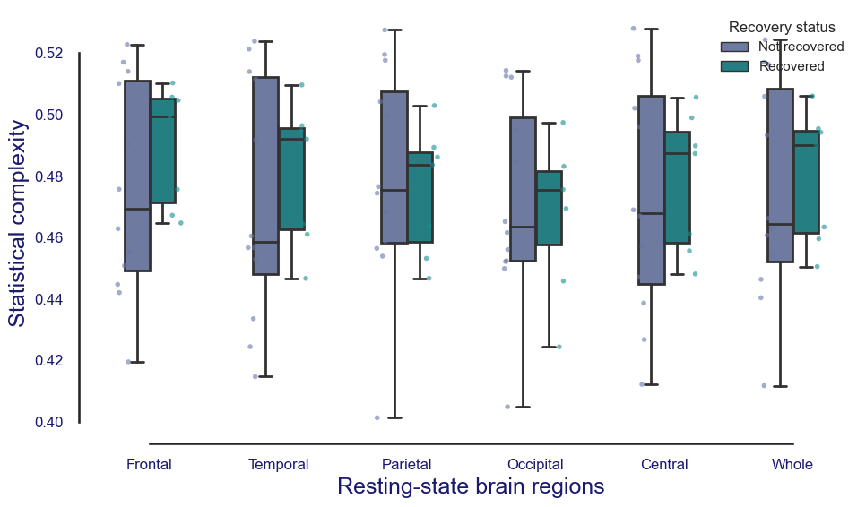
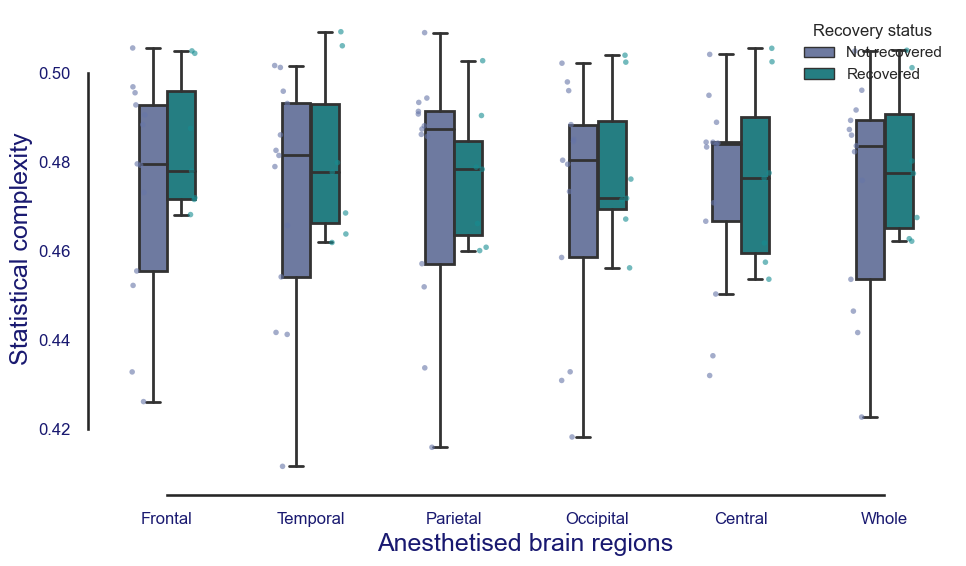
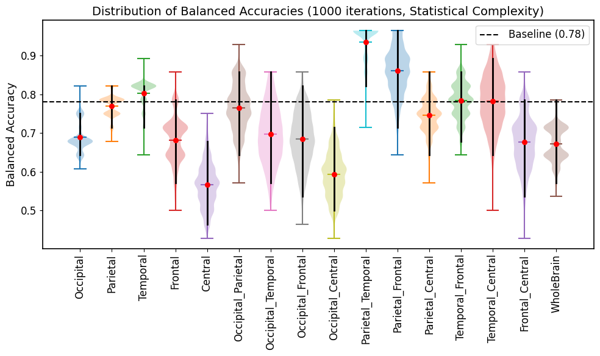
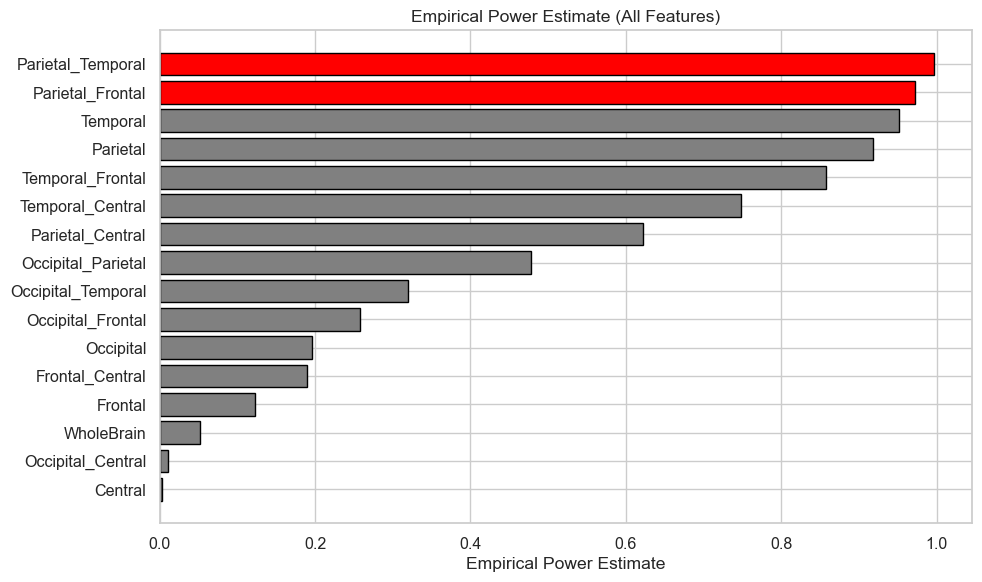
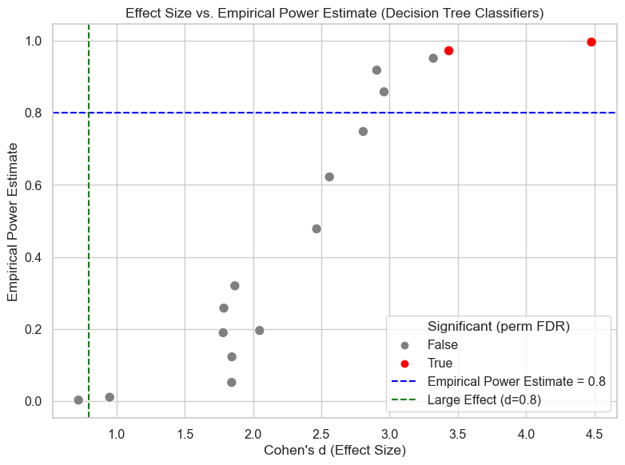
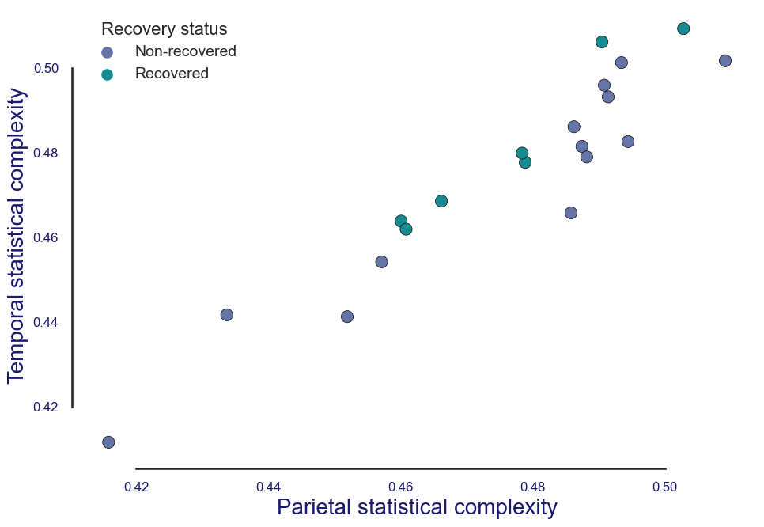
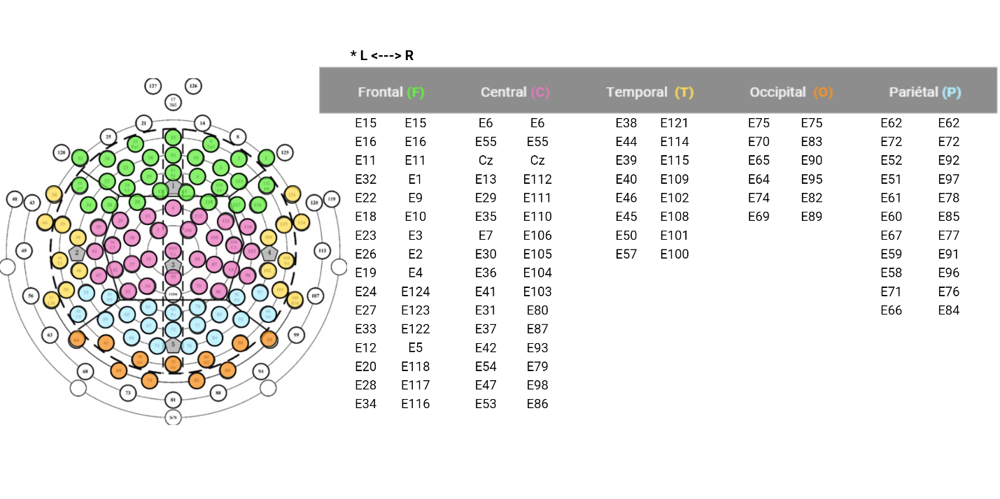

# Regional statistical complexity and consciousness recovery

**Research-code companion · EEG · statistical learning · neuroprognostication**

This repository presents a clean version of the statistical-learning analysis accompanying the manuscript **“Regional statistical complexity under propofol reveals neural correlates of consciousness recovery.”** It investigates whether regional EEG statistical complexity measured during propofol is associated with subsequent recovery of consciousness in patients with severe brain injury.

> **Data access:** Raw EEG and participant-level derived feature tables are not publicly distributed because of patient confidentiality and institutional data-governance requirements. The notebook requires an authorized local input table. No patient data are included here.

## Study at a glance

- **Cohort:** 20 patients with disorders of consciousness; 7 recovered at three months.
- **Signals:** resting-state and propofol EEG, analyzed separately.
- **Measurements:** Lempel–Ziv complexity, permutation Lempel–Ziv complexity, permutation entropy, and statistical complexity.
- **Spatial representations:** five cortical regions, ten two-region combinations, and whole brain.
- **Inference:** fixed depth-3 decision trees, repeated stratified 7-fold cross-validation, label-permutation tests, and Benjamini–Hochberg false-discovery-rate correction.

## Main findings reported in the manuscript

The **parietal–temporal** model showed the strongest association with recovery (permutation *p* < 0.001; FDR-adjusted *p* < 0.001). The **parietal–frontal** model also survived FDR correction (permutation *p* = 0.004; FDR-adjusted *p* = 0.032).

The parietal–temporal model also exceeded the prespecified literature-derived 78% comparison benchmark (*p* = 0.011; reported 95% interval 0.821–0.964). Other measurements and resting-state models did not survive the study's FDR correction. These are **manuscript-reported results**, not freshly generated output from the public notebook.

## Figures from the manuscript

The following figures are reproduced from the supplied manuscript. **Manuscript tables are excluded.** These figures are not regenerated by the public notebook.

### Figure 1a — Resting-state complexity



### Figure 1b — Anesthesia complexity



### Figure 2a — Prognostic performance



### Figure 2b — Estimated empirical power



### Figure 2c — Effect size versus empirical power



### Figure 3 — Parietal–temporal complexity plane



### Figure 4 — EEG channel mapping



## Notebook

[`regional_complexity_prognosis.ipynb`](regional_complexity_prognosis.ipynb) — cleaned implementation of the original statistical-learning workflow, with explanatory notes and no embedded confidential data or execution outputs.

### Running locally

```bash
python -m pip install -r requirements.txt
jupyter notebook regional_complexity_prognosis.ipynb
```

Place an **authorized** table at `private_data/propofol_features.csv` containing `Recovery` (0/1), `Occipital`, `Parietal`, `Temporal`, `Frontal`, `Central`, and optionally `Whole`. One row corresponds to one participant. The `private_data/` directory is excluded from version control. Never commit patient identifiers or outcomes.

The notebook covers statistical learning on precomputed features, **not** raw EEG preprocessing or ordinal-pattern extraction. Its controlled random seeds and cleaned implementation are not guaranteed to reproduce every numerical value from the historical research environment. No independent external validation was performed.

## Research context

The results suggest that recovery-related information may depend on the **joint nonlinear configuration** of statistical complexity across regions under propofol, rather than whole-brain averages or individual-region mean differences. The small sample and lack of an external validation cohort mean this remains an exploratory candidate neural correlate, not a clinically deployable prognostic biomarker.

**Author:** Guillermo Martinez Villar and collaborators. See the accompanying manuscript for full authorship, methodology, and interpretation.
